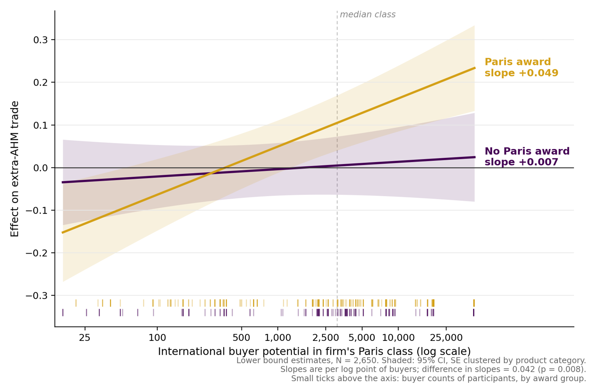
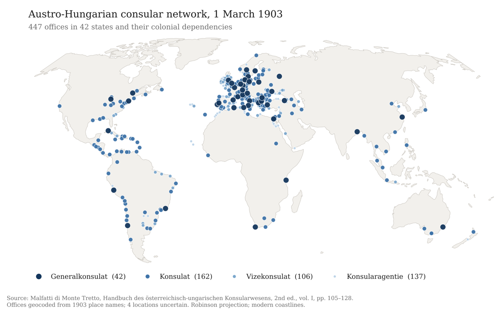
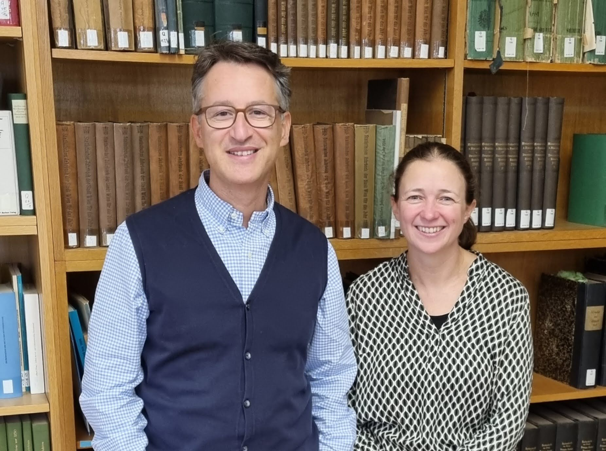

IP-KuK &middot; FWF&ndash;DFG research project &middot; 2026&ndash;2028

**Gábor Békés (CEU) and Claudia Steinwender (LMU)**

  
FundersFWF (Austria) and DFG (Germany), <a href="https://www.fwf.ac.at/en/funding/portfolio/international-collaborations/germany" target="_blank" rel="noopener">Weave</a> scheme

  
Funding&euro;800,000

  
DurationThree years, from 1 January 2026

  
TeamsCEU Vienna &middot; LMU Munich

<a href="#the-research-project">Project</a><a href="#papers">Papers</a><a href="#the-team">Team</a><a href="#the-grant">Grant</a>

## The research project

The IP-KuK project examines industrial policy in the Austro-Hungarian Monarchy (1870–1910) to understand how export promotion and targeted tariff policies affect economic development. We focus on two historical interventions: the 1900 Paris Exhibition’s role in promoting Hungarian firms internationally, and export-contingent input tariff reductions in the milling industry during the 1880s. These policies offer insights into mechanisms that remain relevant for contemporary industrial policy debates, particularly in low- and middle-income countries seeking export-led growth.

The project creates new firm-level panel datasets from previously unexplored archival sources in Vienna, Budapest, and regional libraries, covering the 1870–1910 period. In addition to extensive archival work, we employ machine learning and genAI methods to enhance digitization and entity recognition efforts.

We employ quasi-experimental methods to identify causal effects on firm performance, technology adoption, and regional development. The historical setting provides cleaner identification than modern contexts, where multiple interventions overlap, and also allows us to study the role of cultural and ethnic diversity—an issue with clear parallels to modern multiethnic economies such as the European Union. Additionally, we are compiling the first comprehensive catalog of industrial policies implemented in the Austro-Hungarian Monarchy, addressing a major gap in the literature on 19th-century state intervention outside Western Europe.

## Papers

  <h3><a href="https://matyas-molnar.github.io/files/paris_exhibition.pdf" target="_blank" rel="noopener">What Happens in Paris, Does Not Stay in Paris: Trade Fairs and Search and Matching Frictions</a></h3>
  
Gábor Békés, Mátyás Molnár and Claudia Steinwender &mdash; CEPR Discussion Paper 21574, June 2026; revised October 2026

  <figure class="pub-figure">
    
    <figcaption>Paris award winners gained more where they faced more potential international buyers; for participants without an award the effect is flat. Lower-bound estimates with 95% confidence intervals.</figcaption>
  </figure>
  

Abstract

    
Search and matching frictions keep firms from forming international trade links. Trade fairs are a common, often subsidized remedy, yet causal evidence is scarce. We study Hungarian firms at the 1900 Paris World Exhibition. A trial exhibition in Budapest four years earlier had sorted firms into award classes that revealed their export potential before selection. This allows us to bound the effect with control firms from the award class above and below. We build a panel of 3,614 manufacturing firms for 1896–1909 from over 12,000 records across eleven historical sources. Participation raised the probability of exporting outside Austria-Hungary by 4.2 to 18.3 percentage points, against a 15 percent baseline, and the effect was still visible in 1909. The gains went to firms already exporting and were largest where there were many buyers and few domestic rivals. Patenting also rose, though innovation came with exporting rather than alongside it, and employment grew by 17.7 to 27.1 percent over eight years. These are private returns to selected participation: the fair is a congestible platform, so sending more similar firms need not deliver the same gain.

  

  
<a href="https://matyas-molnar.github.io/files/paris_exhibition.pdf" class="btn btn--small" target="_blank" rel="noopener">Latest version (PDF)</a><a href="https://cepr.org/publications/dp21574" class="btn btn--small" target="_blank" rel="noopener">CEPR DP</a><a href="https://github.com/gbekes/working-papers/blob/main/bekes-WU-2026-03-04-90m.pdf" class="btn btn--small" target="_blank" rel="noopener">Slides</a>

  <h3><a href="https://matyas-molnar.github.io/files/JMP.pdf" target="_blank" rel="noopener">Finding Buyers: Information and Trade Promotion in the First Globalization</a></h3>
  
Mátyás Molnár &mdash; Job market paper, November 2026

  <figure class="pub-figure">
    
    <figcaption>The Austro-Hungarian consular network in 1903: 447 offices in 42 states. Consular offices collected the information on foreign buyers that the paper studies.</figcaption>
  </figure>
  

Abstract

    
Information frictions impede the formation of buyer–supplier linkages and are particularly severe across national borders. Because information about foreign buyers is costly to acquire privately but can be shared at negligible marginal cost, governments fund export promotion agencies to supply it. This paper estimates how much providing publicly available information about foreign buyers increases firms’ export market participation. Identification comes from the administratively predetermined rotation of buyer listings published by 19th-century Austro-Hungarian consular offices. They covered only a few countries per issue for reasons of space constraints rather than commercial priority. The setting isolates the information channel since consular listings were close to the only public signal firms received about buyers abroad. I construct a novel panel linking 5,500 Austro-Hungarian exporting firms over 1890–1898 to decompose which features of public buyer information drive exports. Publication alone raises the probability of entering a destination by 5.7% over the baseline of 4.9%. When the listed buyers are predominantly intermediaries, the effect reaches 18.3% and entrants are more likely to survive past the first year. Buyer counts matter as much as buyer identity for entering new markets.

  

  
<a href="https://matyas-molnar.github.io/files/JMP.pdf" class="btn btn--small" target="_blank" rel="noopener">Paper (PDF)</a><a href="https://matyas-molnar.github.io/" class="btn btn--small" target="_blank" rel="noopener">Mátyás's website</a>

## The team

#### Principal investigators

  

    <h3><a href="https://people.ceu.edu/gabor_bekes">Gábor Békés</a></h3>
    
Associate Professor, Department of Economics, Central European University, Vienna. Leads the CEU team.

  

  

    <h3><a href="https://www.econ.lmu.de/en/persons/contact-page/claudia-steinwender-8e9b8882.html">Claudia Steinwender</a></h3>
    
Professor, Department of Economics, Ludwig-Maximilians-Universität Munich. Leads the LMU team.

  

<figure class="pub-figure team-photo">
  
  <figcaption>LMU Munich Economic History Library, Austria section.</figcaption>
</figure>

#### Team members

  

    <h3><a href="https://www.attilagaspar.com/">Attila Gáspár</a></h3>
    
Head of data and AI &middot; CEU

    
Postdoc at CEU since January 2026. His main fields are applied micro and political economy. He has been building AI tools to learn from historical documents.

  

  

    <h3><a href="https://matyas-molnar.github.io/">Mátyás Molnár</a></h3>
    
PhD student &middot; CEU

    
Interested in economic history and political economy. He has been part of the research work from the start.

  

  

    <h3>Tommaso Petrelli</h3>
    
Pre-doctoral researcher &middot; LMU Munich

    
Joined the Munich team after a master's degree at Bocconi University.

  

#### External partners

[Réka Juhász](https://economics.ubc.ca/profile/reka-juhasz/) of the University of British Columbia (CA) and [Tamás Vonyó](https://sps.unibocconi.eu/people/tamas-vonyo) of Bocconi University (IT).

## The grant

This three-year project is funded by the Austrian Science Fund (FWF), grant no. 10.55776/PIN3964525, and the German Research Foundation (DFG), grant no. 564732427, via the wonderful [Weave](https://www.fwf.ac.at/en/funding/portfolio/international-collaborations/germany) collaboration scheme connecting European science. Total funding is 800 thousand euros. The project started on 1 January 2026.
